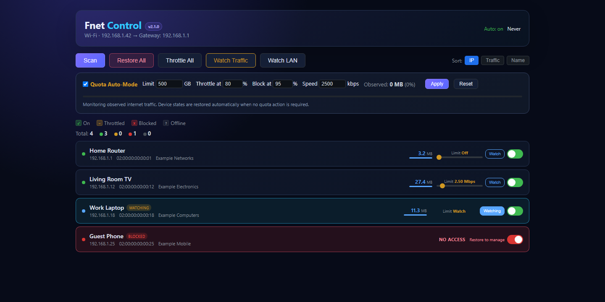

# Fnet — NetCut Pro


An interactive network management, auditing, and **bandwidth control** tool written in Python with a web UI. It scans your local subnet, identifies connected devices (hostname + MAC vendor), and lets you control their internet access using ARP cache poisoning — cutting them off, rate-limiting them, or enforcing an internet quota automatically.

**⚠️ Disclaimer:** This tool is strictly for educational purposes and authorized penetration testing. You must only run this on networks you own or have explicit, written permission to audit. The author is not responsible for any misuse or damage caused by this software.

---

## What's New in v2.1.1

* Enforces the selected cap across small TCP ACK/DNS/control frames as well as bulk data. Control frames retain queue priority but no longer bypass the token bucket.
* Reduces the burst window from one second to 100 ms so short iPhone speed tests reflect the configured rate.

### Previous v2.1.0 improvements

* Fixed the bidirectional ARP responder so gateway replies go back to the target device instead of being misdirected to the gateway.
* Re-poisons both ARP legs immediately when a genuine device or gateway reply tries to repair the path.
* Added **Relay active**, **Relay waiting**, **No traffic intercepted**, and **Relay error** health badges.
* Added **Watch LAN** for clients behind a bridged Wi-Fi access point.
* Increased ARP refresh frequency for devices that aggressively refresh their neighbor cache.

### Previous v2.0.0 improvements

* Redesigned navy, violet, and cyan dashboard with clearer control and device states.
* Rebuilt quota state management: disabling or resetting Auto-Mode restores every device to its previous manual state.
* Correct single-count quota accounting that excludes relay duplicates, LAN-only transfers, and blocked packet attempts.
* Blocked devices now show **No access** instead of a misleading historical traffic value.
* Fixed block actions for watched/throttled devices, live quota downgrades, newly discovered devices, and persistent manual limits.
* Fixed **Restore All** so it disables Auto-Mode and restores devices without stopping capture or automatic scanning.
* Added subnet-aware discovery, atomic state saving, validated API inputs, and regression tests for quota and traffic logic.

---

## Quick Start

Fnet needs elevated privileges because ARP discovery, packet capture, and raw packet forwarding operate below the normal application networking layer.

| OS | Requirements | Install and run |
|----|--------------|-----------------|
| Windows 10/11 | Python 3.12+, [Npcap](https://npcap.com/) with WinPcap API compatibility, Administrator terminal | `py -m pip install -r requirements.txt` then `py app.py` |
| Linux | Python 3.10+, libpcap, root privileges | `python3 -m pip install -r requirements.txt` then `sudo python3 app.py` |

After startup, open [http://localhost:5000](http://localhost:5000). Windows users can also right-click a terminal, choose **Run as administrator**, and launch `Launch NetCut.bat`.



> The screenshot uses fictional device names, IP addresses, and MAC addresses. Fnet displays devices discovered on your own local network.

---

## Features

### Network Control
* **Dynamic Interface Selection** — Auto-detects active network interfaces and resolves their IP / Gateway configuration.
* **Comprehensive Scanning** — Discovers local devices and resolves Hostnames (reverse DNS) and Hardware Vendors (MacVendors API).
* **One-Click Block / Restore** — Cut any device off from the gateway with ARP poisoning, then restore it cleanly.
* **Live Traffic Monitor** — Real-time per-device traffic counters with a web UI bar graph.
* **Auto-Rescan** — Keeps the device list fresh automatically (`8s` interval).
* **Graceful Restoration** — Restores all ARP tables on exit, so nothing stays cut off.

### Throttling (Real Bandwidth Shaping)
* **Per-Device Speed Control** — Drag a slider on any device card to cap its internet speed from **0 up to 30 Mbps** (router-speed default).
* **Real MITM Rate Limiting** — `TokenBucketForwarder` ARPs-poison the target so its traffic crosses your NIC, then applies a token bucket to the relayed frames — dropping what exceeds your configured bit-rate. WhatsApp/text keeps working; heavy video throttles down. The relay uses a **single persistent raw socket** (not one socket per packet) so full-speed links still relay reliably.
* **Throttle All** — One-click apply a limit to every device at once.
* **Persistent state** — Limits survive rescans (stored in `devices.json`).

### Traffic Watch
Watch which websites each device is visiting, live:
* Pulled from **TLS SNI** (HTTPS), **DNS queries**, and **HTTP `Host` headers** — no decryption needed.
* Per-device domain list with hit counts and last-seen timestamps.
* **Watch Traffic** modal with 60s / 5min / 30min / all-time ranges.
* **Per-device "Watch" toggle** — press Watch on any card to relay that device through your NIC at full speed (no throttling) so its traffic becomes visible even when you don't want to limit it. Ideal for access points / routers behind which whole households sit (their domain usage then shows in the watch modal). Watching does *not* block or slow the device.
* **Watch LAN** — routes discovered clients individually through Fnet, which is required when a Wi-Fi access point operates as a transparent bridge.

> **Access point note:** watching an AP's management address (for example, `192.168.1.100`) only observes traffic generated by the AP itself when it is in bridge mode. Client packets retain the phones' and laptops' own IP addresses. Use **Watch LAN**, then open **Watch Traffic**, to observe those clients.

### Quota Auto-Mode
Save your router's monthly internet allowance automatically:
* Set a **monthly limit (GB)**, a **throttle threshold (%)**, and a **block threshold (%)**.
* The app counts observed internet traffic once, excluding relay copies, local device-to-device traffic, and packets attempted while a device is blocked.
* When usage passes the throttle %, **all devices are automatically throttled** to your chosen speed.
* When it passes the block %, **all devices are blocked** entirely.
* When Auto-Mode is disabled or reset, each device returns to the manual state it had before quota enforcement began.
* Reset the meter for a new billing period with one click.

---

## Prerequisites

* Windows 10/11: Python 3.12+ and [Npcap](https://npcap.com/) installed with **WinPcap API-compatible mode** enabled.
* Linux: Python 3.10+ and a libpcap package supplied by your distribution (for example, `libpcap-dev` on Debian/Ubuntu).
* Administrator/root access for ARP and raw-socket operations.

The current compatibility targets are Python 3.12+ on Windows and Python 3.10+ on Linux. Other Python 3 versions may work but are not part of the documented support target.

---

## Installation & Run

```bash
git clone https://github.com/MatsoDev/Fnet.git
cd Fnet
python -m pip install -r requirements.txt
```

Then run one of the following from an elevated terminal:

```powershell
# Windows (Administrator PowerShell)
py app.py
```

```bash
# Linux
sudo python3 app.py
```

1. The app auto-selects your active interface + gateway and scans the network.
2. Open the web UI: **http://localhost:5000**
3. Use the **Scan / Restore All** buttons, the per-device **block toggle** and **limit slider**, and configure the **Quota Auto-Mode** panel.

**CLI only?** Use `netcut.py` for the original terminal interface:
```bash
sudo python3 netcut.py
```

Select the network interface, choose a device to toggle its access, press `r` to rescan, or press `q` to quit and restore the network.

---

## How It Works

Fnet first discovers hosts on the local IPv4 subnet with ARP requests. When a device is blocked, watched, or throttled, Fnet sends carefully targeted ARP replies that make the device and gateway address traffic through the machine running Fnet. The forwarding engine then chooses what to do with each frame:

* **Block:** do not relay traffic for the selected device.
* **Watch:** relay at full speed while recording visible DNS queries, HTTP host headers, and TLS Server Name Indication (SNI). Encrypted page contents remain encrypted.
* **Throttle:** relay through a token-bucket queue capped at the selected rate.

When a control is disabled or Fnet exits normally, it sends corrective ARP replies so the device and gateway learn each other's real MAC addresses again. This design is limited to the local Layer 2 network and can be blocked by client isolation, static ARP entries, Dynamic ARP Inspection, or similar switch/router protections.

---

## Troubleshooting

### Windows says Npcap/WinPcap is missing

Install the latest [Npcap](https://npcap.com/) release and enable **Install Npcap in WinPcap API-compatible Mode** in the installer. Close and reopen the Administrator terminal afterward.

### The app says to run as Administrator or root

Raw packet access is restricted by the operating system. On Windows, start PowerShell or Command Prompt with **Run as administrator**. On Linux, launch the app with `sudo python3 app.py`.

### A scan finds no devices

Confirm that the selected interface is the physical Wi-Fi/Ethernet adapter connected to the target LAN, not a VPN or virtual adapter. Guest Wi-Fi and access points with client isolation prevent peer discovery. Some hosts also ignore ARP probes while asleep.

### Blocking, watching, or throttling has no effect

The target must share the same broadcast domain as the Fnet host. Managed networks may intentionally stop ARP redirection with client isolation, Dynamic ARP Inspection, port security, or static neighbor entries. Fnet does not bypass those protections.

After enabling a limit or watch, check its relay badge:

* **Relay active** means frames are crossing Fnet and the control is operating.
* **Relay waiting** means the target has not produced traffic yet.
* **No traffic intercepted** after using the target means the network is bypassing or blocking ARP redirection. Confirm both devices are on the same LAN and disable AP/client isolation where you administer the network.

### The web UI does not open

Keep the terminal running and browse to [http://127.0.0.1:5000](http://127.0.0.1:5000). If port 5000 is already occupied, stop the conflicting process before restarting Fnet. Review the terminal output for the underlying startup error.

---

## Project Layout

| File | Purpose |
|------|---------|
| `app.py` | Flask web backend + controller, ARP spoofing, token-bucket throttling, quota engine |
| `templates/index.html` | Web UI (device cards, throttle sliders, quota panel) |
| `netcut.py` | Original CLI client |
| `requirements.txt` | Python runtime dependencies |
| `docs/dashboard.png` | Dashboard screenshot with fictional sample data |
| `tests/test_app.py` | Regression tests for traffic accounting, blocking, restoration, and quota transitions |
| `devices.json` | Saved device names, block/throttle states, quota (auto-generated) |

Run the regression suite without touching the network:

```bash
python -m unittest discover -s tests -v
```

---

## License

This repository does not currently include a software license. Copyright remains with the repository owner unless and until a `LICENSE` file is added. The authorization and safety disclaimer above describes intended use; it is not a software license.

## Legal and Responsible Use

For educational and authorized security testing only. Use responsibly on networks you own or manage.
